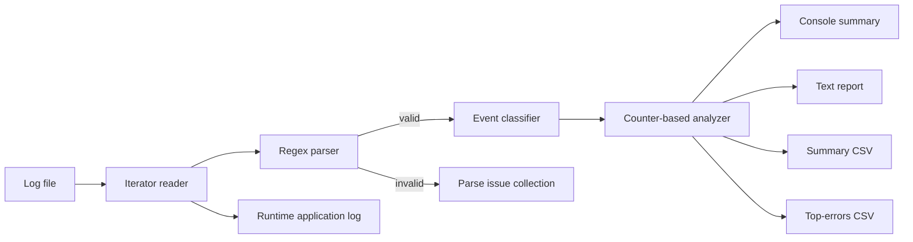

# Log File Analyzer & Error Monitoring Tool

A standard-library-only Python utility that streams application log files, parses structured events, classifies them, groups recurring errors, and produces operational reports.

## What it delivers

- Iterator-based file reading, so large logs are not loaded into memory.
- Regex parsing for two common log layouts.
- INFO, DEBUG, WARNING/WARN, ERROR, CRITICAL/FATAL handling.
- Rule-based categories: `DATABASE`, `AUTHENTICATION`, `FILE_SYSTEM`, `NETWORK`, `VALIDATION`, `PERFORMANCE`, and `GENERAL`.
- `collections.Counter` analysis by level, module, category, warning pattern, and error pattern.
- Error normalization that groups events even when IDs, IP addresses, UUIDs, or numeric values change.
- Console summary.
- Detailed text report.
- Summary CSV report.
- Ranked top-error CSV report.
- Rotating application/runtime log.
- Graceful handling of missing files, permission errors, bad encodings, malformed lines, and invalid arguments.
- Fifteen automated tests using Python's built-in `unittest` framework.

## Project structure

```text
log_file_analyzer_tool/
├── log_analyzer/
│   ├── __init__.py
│   ├── __main__.py
│   ├── analyzer.py
│   ├── classifier.py
│   ├── cli.py
│   ├── exceptions.py
│   ├── logging_config.py
│   ├── models.py
│   ├── parser.py
│   └── reporting.py
├── sample_logs/
│   ├── application.log
│   └── edge_cases.log
├── tests/
│   ├── test_analyzer.py
│   ├── test_classifier.py
│   ├── test_cli.py
│   ├── test_parser.py
│   └── test_reporting.py
├── reports/                 # Generated demo output
├── main.py
├── pyproject.toml
├── PROJECT_PLAN.md
├── DEMO_CHECKLIST.md
├── run_demo.bat
└── run_demo.sh
```

## Supported input formats

Pipe-delimited format:

```text
2026-10-20 08:01:14 | ERROR | database | Database timeout for order_id=1001
```

Bracket format:

```text
2026-10-20 08:09:19 [ERROR] database - Database timeout for order_id=1002
```

Accepted timestamps include:

```text
2026-10-20 08:01:14
2026-10-20 08:01:14,125
2026-10-20T08:01:14Z
2026-10-20 08:01:14+05:30
2026-10-20 08:01:14+0530
```

Accepted levels are `DEBUG`, `INFO`, `WARNING`, `WARN`, `ERROR`, `CRITICAL`, and `FATAL`. `WARN` is normalized to `WARNING`; `FATAL` is normalized to `CRITICAL`.

## Run the analyzer

The project requires Python 3.10 or newer and has no third-party runtime dependencies.

### Windows PowerShell or Command Prompt

```powershell
cd log_file_analyzer_tool
py -m log_analyzer sample_logs\application.log --output-dir reports --top 5
```

Or run the included demo script:

```powershell
run_demo.bat
```

### macOS or Linux

```bash
cd log_file_analyzer_tool
python3 -m log_analyzer sample_logs/application.log --output-dir reports --top 5
```

Or:

```bash
chmod +x run_demo.sh
./run_demo.sh
```

## Command-line options

```text
usage: log-analyzer [-h] [-o OUTPUT_DIR] [--top TOP]
                    [--encoding ENCODING] [--strict] [--verbose]
                    log_file
```

- `log_file`: input `.log` file.
- `-o`, `--output-dir`: report destination; default is `reports`.
- `--top`: number of recurring errors to show; default is `5`.
- `--encoding`: input-file encoding; default is `utf-8`.
- `--strict`: stop on the first malformed line and return exit code `3`.
- `--verbose`: show detailed runtime logging on the console.

Example with strict validation:

```bash
python -m log_analyzer sample_logs/edge_cases.log --strict
```

## Generated output

A successful run creates:

| File | Purpose |
|---|---|
| `analysis_report.txt` | Human-readable operational report |
| `analysis_report.csv` | Overview and counts by level, category, and module |
| `top_errors.csv` | Ranked recurring-error list with sample and time range |
| `analyzer_runtime.log` | Internal execution, warning, and failure log |

The included sample produces this overview:

```text
Physical lines        : 30
Parsed entries        : 29
Malformed lines       : 1
Parse success rate    : 96.67%
Errors/Critical       : 16
Warnings              : 5
```

Its two most frequent normalized errors are:

```text
3x database | Database timeout while fetching order_id=<num>
3x database | Deadlock detected for transaction_id=<num>
```

The `<num>` placeholder is intentional. It allows messages with different transaction or order IDs to be counted as the same operational problem.

## How the processing pipeline works



### 1. Streaming read

`iter_log_records()` opens the file and yields one parsed record at a time. This satisfies the iterator requirement and scales better than `read()` or `readlines()`.

### 2. Parsing

`parse_log_line()` tries the pipe and bracket regex patterns. It returns either:

- a `LogEntry`, or
- a `ParseIssue` containing the line number, raw line, and reason.

### 3. Classification

`classify_event()` checks the module and message against ordered regex rules. Module text is included so a database timeout remains `DATABASE` rather than being classified only as `NETWORK`.

### 4. Recurring-error detection

`normalize_message()` replaces volatile values such as IP addresses, UUIDs, and standalone numbers. The analyzer then builds a stable signature:

```text
module | normalized message
```

`Counter.most_common()` supplies the ranked error list.

### 5. Reporting

All output writers consume the same `AnalysisResult`, keeping the console, text, and CSV reports consistent.

## Run the tests

```bash
python -m unittest discover -s tests -v
```

Expected result:

```text
Ran 15 tests
OK
```

The tests cover:

- both supported log formats;
- timestamp and level normalization;
- malformed and unsupported records;
- category rules and dynamic-value normalization;
- counts and recurring-error grouping;
- empty input;
- text and CSV output;
- successful CLI execution;
- strict-mode failure behavior.

## Evaluation-criteria mapping

| Criterion | Weight | Implementation evidence |
|---|---:|---|
| Parsing | 25% | `parser.py`, two regex formats, timestamp parsing, aliases, malformed-line records |
| Analysis | 25% | `analyzer.py`, `Counter`, normalized signatures, top errors, time range |
| File/data structures | 15% | Iterator reading, dataclasses, counters, dictionaries, CSV/text files |
| Error handling/logging | 15% | Custom exception, guarded CLI, strict mode, rotating runtime log |
| Testing | 10% | Fifteen `unittest` cases across five test modules |
| Demo | 10% | Sample logs, generated reports, scripts, and `DEMO_CHECKLIST.md` |

## Team split

### Participant 1 — ingestion and classification

- `models.py`
- `parser.py`
- `classifier.py`
- sample log formats
- parser and classifier tests

### Participant 2 — analysis and quality

- `analyzer.py`
- `reporting.py`
- `logging_config.py`
- `cli.py`
- analyzer, reporting, and CLI tests

### Shared integration

- run the full test suite;
- review output files;
- prepare the demo;
- explain one malformed-line case and one normalized recurring-error case.

## Exit codes

| Code | Meaning |
|---:|---|
| `0` | Analysis and report generation succeeded |
| `1` | Unexpected application failure |
| `2` | Invalid argument, file, encoding, permission, or output-directory problem |
| `3` | Strict parsing stopped on a malformed line |

## Extension ideas

- JSON log support.
- Date-range and module filters.
- Error-rate thresholds and alert exit codes.
- Tail/follow mode for live monitoring.
- HTML dashboard or charts.
- Email, Slack, or webhook notifications.
- Configurable category rules loaded from YAML or JSON.
